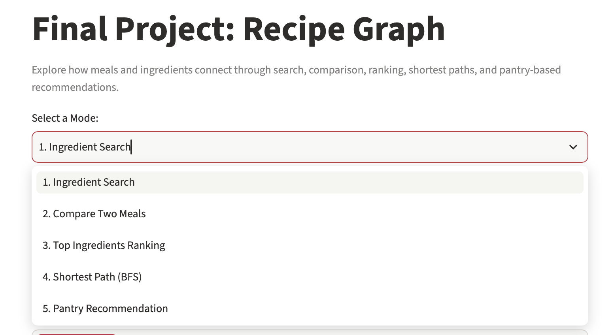
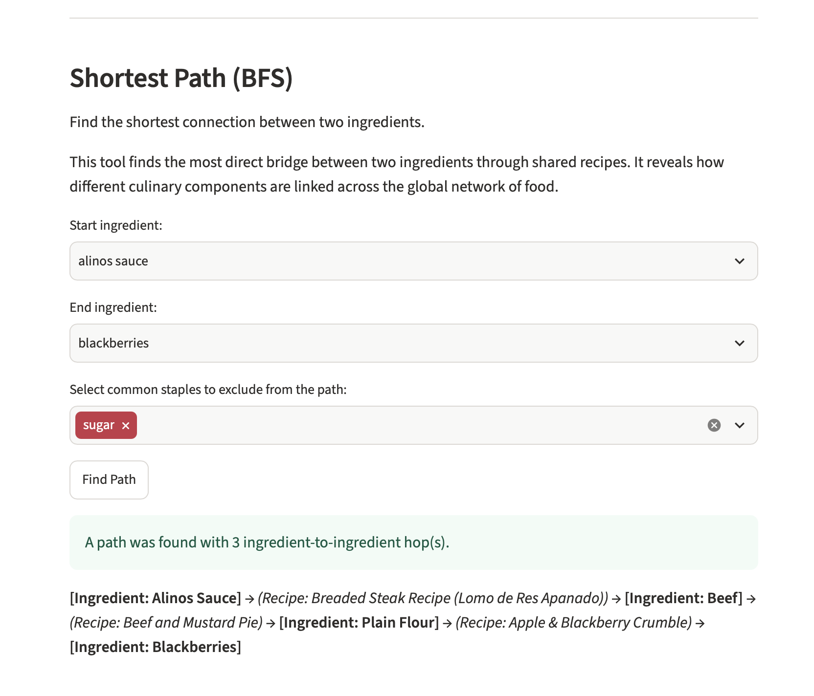
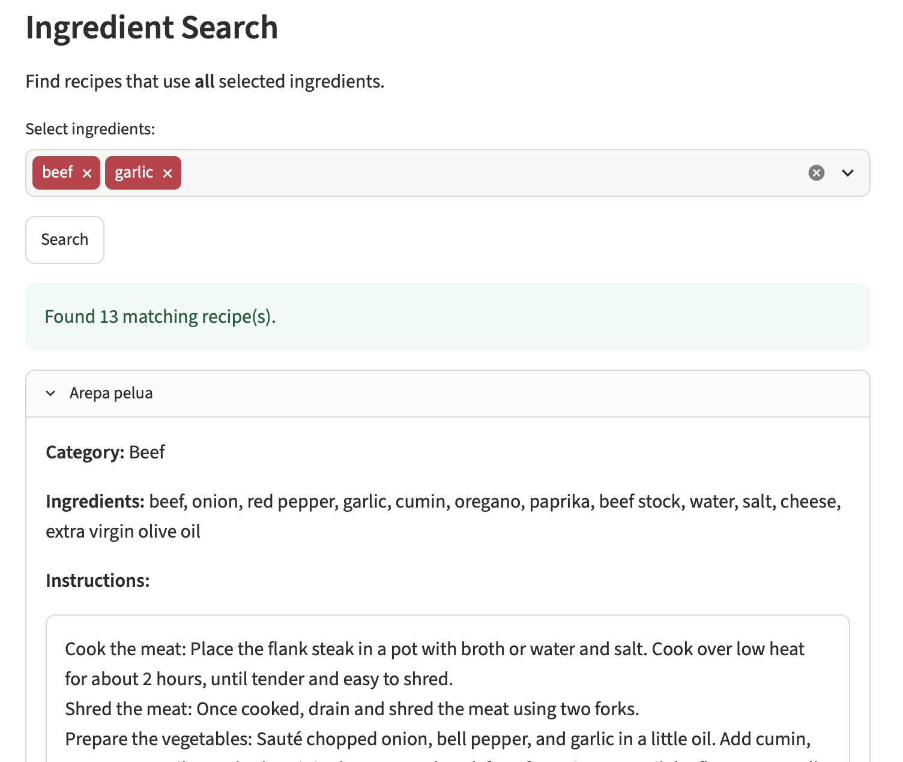

# Recipe Graph Explorer

An interactive app that models recipes as a graph, with meals connected to the ingredients they use, so you can explore food data through search, comparison, ranking, shortest paths, and pantry-based recommendations.

Built for SI 507 (Intermediate Programming) at the University of Michigan School of Information.

<p align="center">
  
</p>

<p align="center">
  
  
</p>
<!-- After deploying, add: **Live demo:** https://your-app.streamlit.app -->

## What it does

The app pulls recipe records from [TheMealDB](https://www.themealdb.com/api.php) and builds an undirected graph. Meal nodes connect to ingredient nodes, and ingredient nodes connect back to meals. Five features run on that graph:

1. **Ingredient search**: find recipes that contain *all* of the selected ingredients.
2. **Compare two meals**: see which ingredients two recipes share.
3. **Top ingredients**: rank ingredients by how many recipes use them (the node's degree), with a bar chart.
4. **Shortest path (BFS)**: find the shortest connection between two ingredients through shared recipes. You can exclude common staples such as salt or water to avoid trivial links.
5. **Pantry recommendation**: enter the ingredients you have and the ones you want to avoid, and get ranked recipes (most matches first, then fewest missing ingredients).

## Design

The code is object-oriented, with four classes in `final_project.py`:

| Class | Responsibility |
|---|---|
| `MealDBAPIClient` | Fetches recipes from TheMealDB, one request per starting letter (a to z) |
| `Recipe` | Cleans a raw API record: strips whitespace, lowercases ingredients, skips blank fields |
| `RecipeGraph` | Stores the graph as an adjacency list and implements search, comparison, ranking, and BFS |
| `RecipeRecommender` | Scores recipes against a pantry list and applies exclusions |

For shortest-path results, the displayed path alternates between ingredient and meal nodes, and the reported distance counts ingredient-to-ingredient hops.

## Testing

`final_project_test.py` uses Python's built-in `unittest`. The tests build a small graph from hand-written `Recipe` objects instead of calling the live API, so they are fast and deterministic. They cover data cleaning, graph construction, search, ranking, shortest paths (including excluded nodes and unreachable ingredients), recommendations, and edge cases such as empty input, missing ingredients, and start equal to end.

## Run it locally

Requires Python 3.9 or newer.

```bash
python3 -m venv venv
source venv/bin/activate        # Windows: venv\Scripts\activate
pip install -r requirements.txt

# Web app
streamlit run final_project_streamlit.py

# Command-line version
python final_project.py

# Tests
python -m unittest final_project_test
```

The app makes 26 API requests on first load and caches the result for the session.

## Project files

```
final_project.py             Data classes, graph, BFS, recommender, and the CLI
final_project_streamlit.py   Streamlit interface (imports from final_project.py)
final_project_test.py        Unit tests
requirements.txt             Dependencies
```

## Data

Recipe data comes from [TheMealDB](https://www.themealdb.com/), accessed through its free public API. This repository does not redistribute the data.

## Author

Min-Yi Chen, University of Michigan School of Information (MSI)
